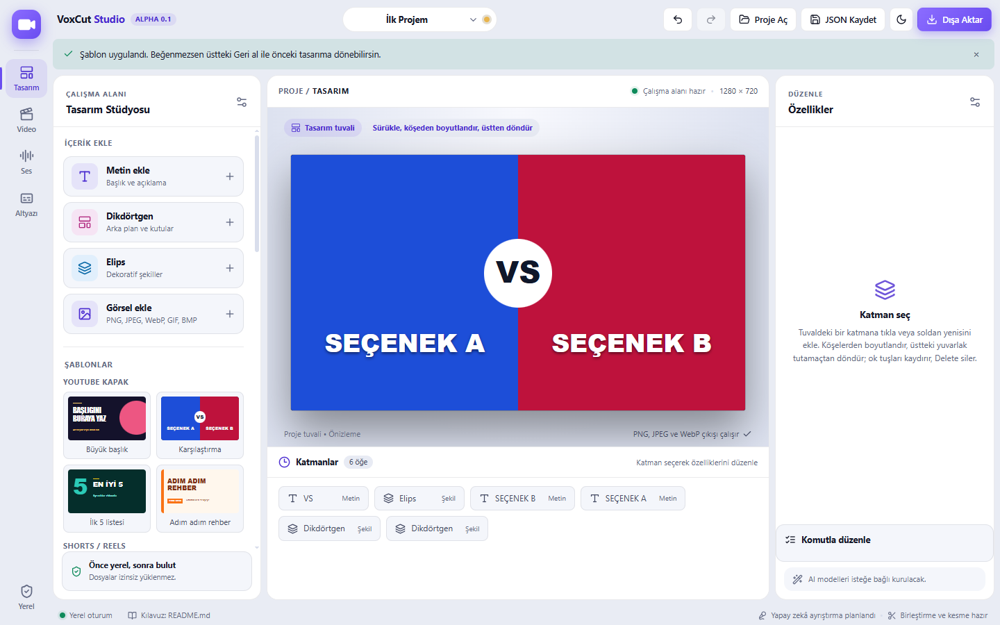
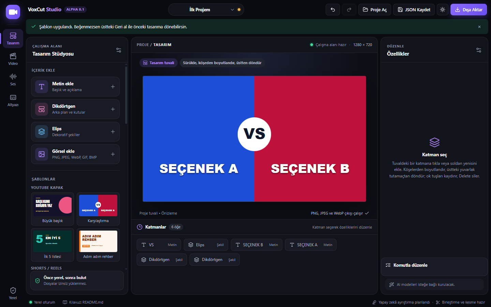

# VoxCut Studio

**Windows için ücretsiz, yerel çalışan tasarım + video + ses + altyazı stüdyosu.**
Hesap yok, abonelik yok, bulut yok: dosyalarınız bilgisayarınızda kalır.

*English: a free, local-first Windows creative studio (design canvas, multi-clip video merge with transitions, audio mixing/ducking, subtitles with offline Whisper). Alpha. Download the installer from [Releases](../../releases).*

> **Durum: ALFA (0.1).** Çalışır ve otomatik testlerle denenmiştir, ama Canva veya CapCut'ın tamamı değildir ve gerçek kullanıcı testlerinden geçmedi. Aşağıdaki "Neler var / neler yok" bölümü dürüst durumu anlatır.

## Ekran görüntüleri

| Açık tema | Koyu tema |
|---|---|
|  |  |

*Tasarım sekmesi, hazır şablon uygulanmış. Görüntüler tarayıcı önizlemesinden alındı; video, ses ve altyazı işlemleri (FFmpeg, Whisper) masaüstü uygulamasında çalışır.*

## İndirme ve kurulum

1. [Releases](../../releases) sayfasından `VoxCut.Studio_..._x64-setup.exe` dosyasını indirin (GitHub dosya adındaki boşlukları nokta yapar). Windows 10/11 (64 bit).
2. Çalıştırın. Yönetici izni gerekmez; kullanıcı klasörünüze kurulur.
3. **İmzasız:** Windows SmartScreen "bilinmeyen yayıncı" uyarısı verebilir. *Daha fazla bilgi → Yine de çalıştır*. Dosyanın bütünlüğünü Release notundaki SHA-256 ile karşılaştırabilirsiniz.
4. FFmpeg setup içinde gelir; ayrıca kurmanız gerekmez.

Otomatik altyazı (Whisper) isteğe bağlıdır ve pakette **yoktur**: Altyazı sekmesindeki "Motoru indir / Modeli indir" düğmelerine bastığınızda resmî kaynaktan iner (motor 9 MB, model 74 MB – 1,5 GB, SHA-256 doğrulanır).

## Neler var

| Alan | Durum |
|---|---|
| **Tasarım** | Metin / şekil / görsel katmanları, sürükle-boyutlandır-döndür, 13 özgün şablon, hazır tuval boyutları, PNG / JPEG / WebP çıktı |
| **Video** | Çok klipli birleştirme (≤ 50 klip), 12 geçiş türü, klip başına renk ayarı, ilerleme + iptal, MP4 (H.264 + AAC) |
| **Ses** | 8 ek kanal, seviye / pan / fade / sustur / solo, konuşurken müzik kısma (ducking), dalga formu, MP4 / WAV / MP3 / FLAC, gürültü temizleme (klasik veya **yapay zekâ / RNNoise**, A/B dinleme), klasik vokal azaltma |
| **Altyazı** | Elle düzenleme, SRT / VTT içe-dışa aktarma, videoya yakma (yazı tipi, renk, kontur, kutu), **Whisper ile yerel otomatik altyazı** |
| **Proje** | Geri al / yinele, otomatik kayıt, kurtarma, taşınabilir `.voxcut` paketi + yedekler, taşınmış medyayı yeniden bağlama |
| **Komutla düzenleme** | "Altyazıyı 2 sn ileri al" gibi Türkçe cümleler: önce plan, onayınızla uygulanır, geri alınabilir (yapay zekâ kullanmaz) |
| **Arayüz** | Koyu / açık tema, erişilebilirlik taramasından geçti (axe-core) |

## Neler yok / sınırlar

- **Yapay zekâ ile enstrüman ayrıştırma** (vokal / davul / bas) yok; yalnız klasik "orta kanal" yöntemi var.
- **Türkçe konuşma tanıma doğruluğu ölçülmedi.** Çıktıyı dinleyerek düzeltin; özel isimlerde ve gürültüde hata yapar.
- Önizleme oynatıcısı birleştirilmiş videoyu göstermez; sonuç dışa aktarınca görülür.
- Keyframe animasyon, 4K proxy, çoklu seçim, mikrofon kaydı, sürüm güncelleme, İngilizce arayüz yok.
- Uzun videolar: 10 dk 1080p birleştirme ölçüldü (≈ 1 dk). Saatlik videolar ve 4K denenmedi.
- Yalnız Windows x64. NVENC/GPU kodlama kullanılmaz (CPU libx264).

Ayrıntılı ve kanıtlı durum: [`docs/FEATURE_MATRIX.md`](docs/FEATURE_MATRIX.md).

## Gizlilik

Uygulama kendiliğinden internete bağlanmaz. Yalnız siz "indir" dediğinizde Whisper motorunu/modelini indirir; ses ve projeleriniz hiçbir yere gönderilmez. Telemetri yoktur. Ayrıntı: [`docs/PRIVACY.md`](docs/PRIVACY.md).

## Kaynaktan derleme

Gerekenler: Node.js 20.19+, Rust (MSVC), Microsoft C++ Build Tools, WebView2, FFmpeg (geliştirirken PATH'te).

```powershell
npm install
npm run dev            # tarayıcıda arayüz (kısıtlı): http://127.0.0.1:1420
npm run desktop:dev    # gerçek masaüstü penceresi
npm test               # birim testleri
npm run desktop:build  # FFmpeg'i indirir (SHA-256 doğrulamalı) ve tek setup üretir
```

Kurulum paketi: `src-tauri\target\release\bundle\nsis\`. Rust testleri: `cd src-tauri; cargo test` (gerçek FFmpeg kullanır; `npm run fetch:ffmpeg` ile indirip `src-tauri
esourcesfmpeg` klasörünü veya kendi FFmpeg'inizi PATH'e ekleyin).

## Dokümanlar

- [`docs/ARCHITECTURE.md`](docs/ARCHITECTURE.md) — mimari
- [`docs/ROADMAP.md`](docs/ROADMAP.md) — aşamalar
- [`docs/FEATURE_MATRIX.md`](docs/FEATURE_MATRIX.md) — ne çalışıyor, ne test edildi
- [`docs/TEST_PLAN.md`](docs/TEST_PLAN.md) — test envanteri
- [`docs/AI_MODELS.md`](docs/AI_MODELS.md) — Whisper kaynakları ve doğrulama özetleri
- [`docs/THIRD_PARTY_NOTICES.md`](docs/THIRD_PARTY_NOTICES.md) — üçüncü taraf lisanslar
- [`docs/PRIVACY.md`](docs/PRIVACY.md) — gizlilik
- [`CONTRIBUTING.md`](CONTRIBUTING.md) · [`SECURITY.md`](SECURITY.md)

## Lisans

VoxCut Studio kaynak kodu **MIT** lisanslıdır ([`LICENSE`](LICENSE)). Kurulum paketine gömülen **FFmpeg GPL v3** lisanslıdır; tam metin ve kaynak bilgisi kurulum klasöründeki `licenses\` altındadır ve [`docs/THIRD_PARTY_NOTICES.md`](docs/THIRD_PARTY_NOTICES.md) içinde açıklanmıştır.

> Not: [`CLAUDE.md`](CLAUDE.md) bu projeyi geliştirirken kullanılan yapay zekâ kodlama asistanının çalışma sözleşmesi ve gelişim günlüğüdür; kullanıcılar için gerekli değildir.
